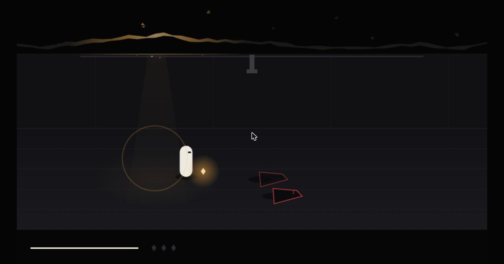

# Upstairs (Наверху)

A small 2.5D beat 'em up built to convey one emotion through mechanics alone: trust. Someone lives on the hidden floor above you. You never see them until the end.

[](https://iansilent.github.io/upstairs/)

**[▶ Play in the browser](https://iansilent.github.io/upstairs/)** · keyboard · about 5 minutes · no text, no dialogue

## The idea being tested

Can a brawler make the player trust a character they cannot see or command?

- You find **sparks**, one universal consumable. Tossing a spark up through a crack means giving a resource away and waiting a second or two with no control.
- The one upstairs catches it and does *something* with the machines in the ceiling: a pipe, a weight, a claw, a lamp, a door. You can only guess what, from where its light goes.
- **Its intent is always good; its execution is imperfect.** It may be late or clumsy, and it says sorry with two knocks. It never hurts you on purpose.
- Later the roles turn around: it gets into trouble and you may free it, or walk past. If you freed it, it comes for you when you are down.

The level can be finished without its help. Its logic is hidden but learnable.

## Controls

| Key | Action |
|---|---|
| WASD / arrows | Move |
| J / Z | Attack (three presses for a combo; in the air, a jump attack) |
| K / X / Space | Jump |
| Walk into an enemy | Grab; then J for a knee, or a direction + J for a throw |
| L / C / E | Toss a spark upstairs (with no sparks: knock on the ceiling) |
| Esc | Pause |
| R | Restart (while paused, or on the end screen) |
| ` | Tuning panel and a log of every decision the helper makes, with its reason |

## What is inside

- One level: two arenas, a sluice puzzle for two, the rope, the dark and a finale.
- [DESIGN.md](DESIGN.md): the emotion formula, the helper's rules and how each scene serves them.

## Run locally

Plain HTML, CSS and JavaScript on a canvas. No build step and no dependencies. Open `index.html`.

## Checks

A bot plays the real simulation headlessly and reports the ending, time, deaths and how each request to the helper went:

```bash
node tools/check.js
```
